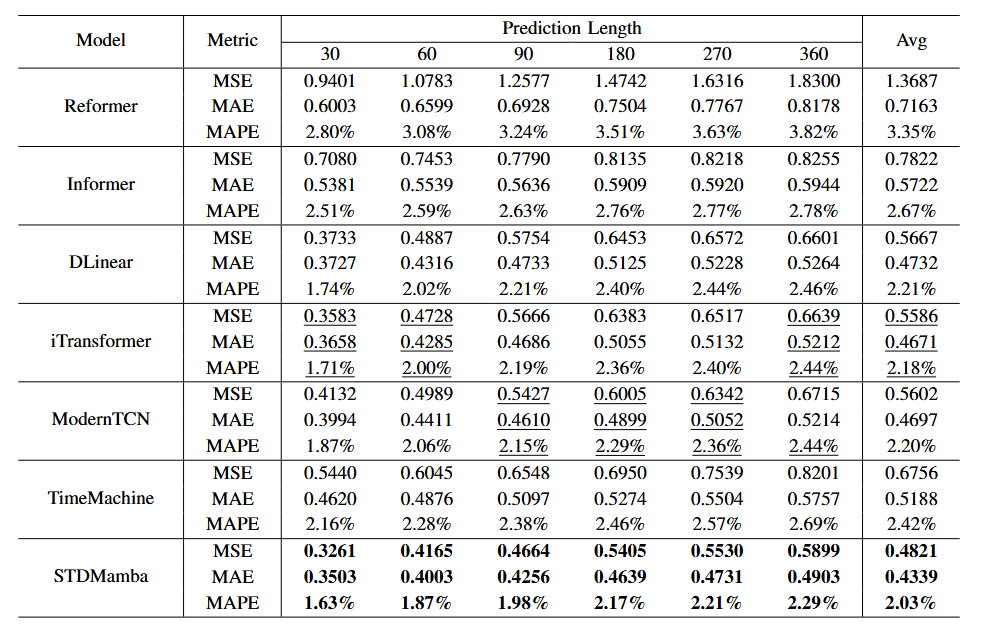
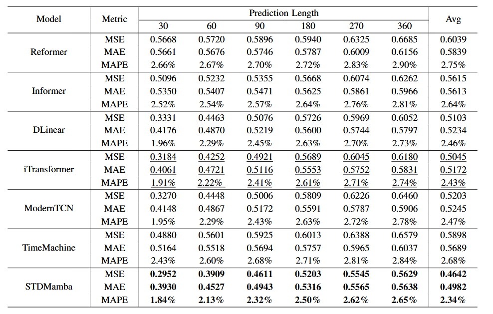

# STDMamba: Spatio-Temporal Decomposition Mamba for Long-Term Fine-Grained SST Prediction

  Xudong Jiang1, Mingshan LOO1, Wengen Li1, Mingrui Zhang1, Jihong Guan1, Shuigeng Zhou3 
  1Tongji University, Shanghai, China &emsp; 
  2Fudan University, Shanghai, China 

## Long-Term Fine-Grained Sea Surface Temperature Prediction based on Mamba2

🚩**News**(June 18, 2025): We have updated and uploaded a pdf file 'Supplementary_Materials.pdf' for the experiments with hyperparameters in the paper as well as the details of the comparative experiments so that they can be reproduced.

🚩**News**(March 31, 2025): We aim to continue to replace the original bi-directional mechanism in next work, commonly used in most time series models, with the directional Mamba mechanism we newly proposed.

🚩**News**(August 16, 2024): To the best of our knowledge, we are the first to introduce state-space models or Mamba into SST prediction, which solves the modeling difficulties and noise challenges of long-term fine-grained prediction and achieves SOTA performance with real datasets, and we will continue to innovate and improve in this direction, so if you are interested, please stay tuned for more information about our work!

# Results✅
## Main Results on the Northwest Pacific dataset

Compared to the current SOTA models, STDMamba achieves superior performance on the Northwest Pacific dataset and Indian Ocean dataset from NOAA’s publicly available Sea Surface Temperature dataset.

## Main Results on the Indian Ocean dataset

